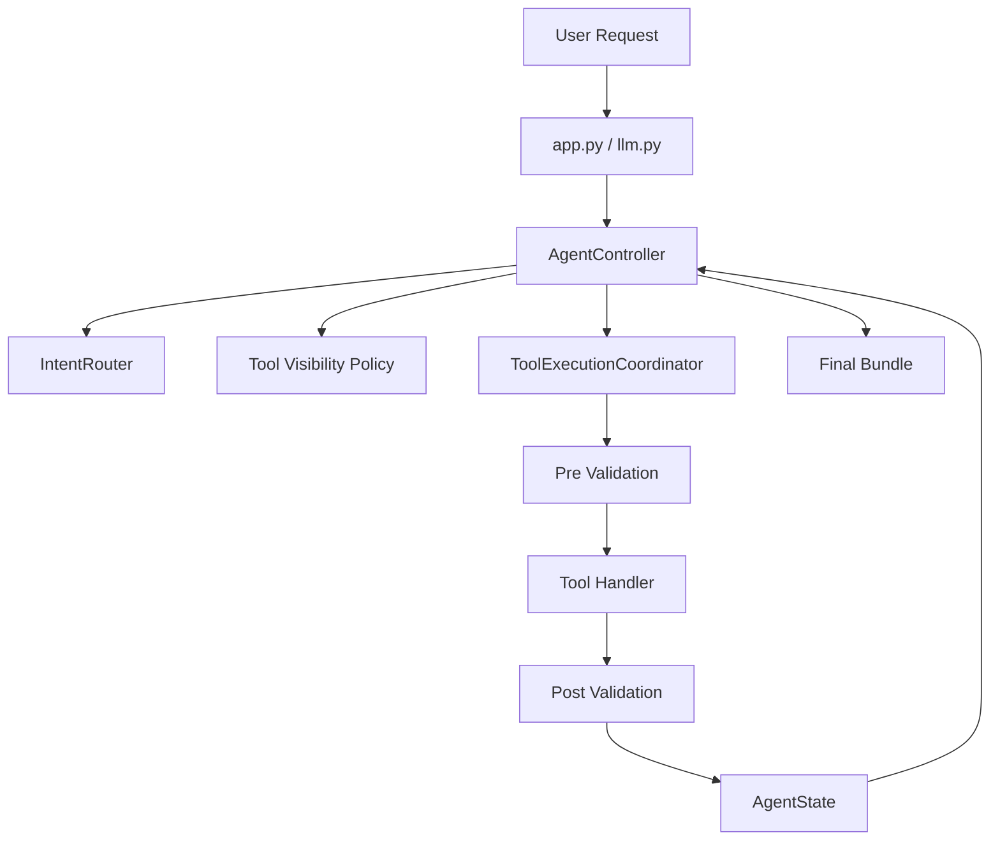
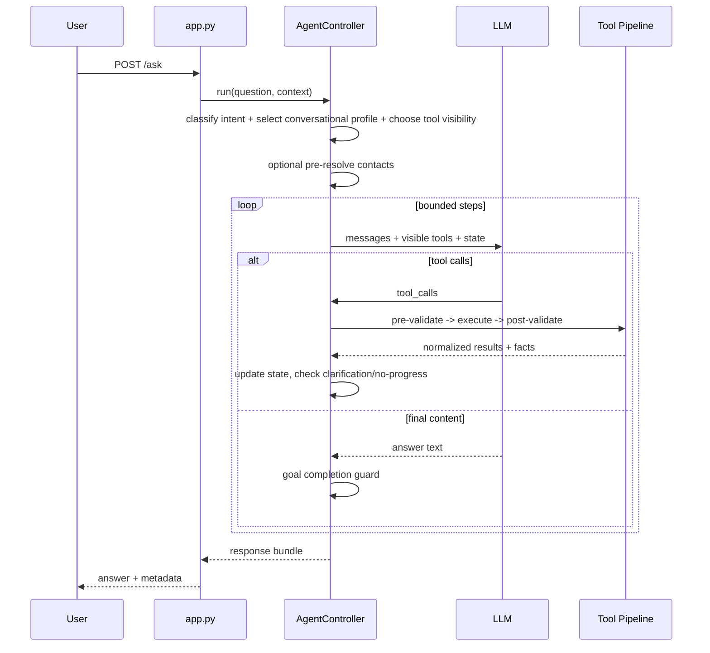

# Bounded Agent Architecture Overview

## Core Principle

**"The model proposes, the controller validates and decides."**

The LLM suggests actions, but the runtime enforces contracts, validates tool usage, and decides whether to continue, escalate, clarify, or stop.

## Messaging Memory

[MESSAGING_MEMORY.md](MESSAGING_MEMORY.md) records the agreed direction for a
personal messaging archive, external identity/contact links, projects, temporal
knowledge, and proactive proposed items. [WHATSAPP_INGESTION.md](WHATSAPP_INGESTION.md)
defines the first-connector plan: Tryx Python bindings over `whatsapp-rust` in the
existing orchestrator container, with live capture and a separate background
history worker feeding the same durable archive pipeline. Native/history capture
guarantees remain to be verified during implementation.
The first archive milestone is implemented with a managed Tryx Python child in
the existing container, authenticated pairing/status, identity linking, durable
post-callback staging, lexical search, and bounded message inspection. Before-ACK
capture, live account coverage, and the later knowledge/project/intelligence
extensions are not established by this milestone; see the implementation boundary
in the connector document.

## Runtime Layers

## Profile-Based Design

The architecture is split into shared runtime and agent-specific policy:

- `backend/orchestrator/agent/`: shared runtime primitives (controller, limits, state, visibility policy, execution pipeline).
- `backend/orchestrator/agents/registry.py`: intent-to-conversational-profile dispatch for generic `/ask` flows.
- `backend/orchestrator/agents/main/`: general conversational profile policy (fallback and non-memory intents).
- `backend/orchestrator/agents/memory_expert/`: memory-focused conversational profile for memory/data/contact intents.

Profile selection contract:

- `ConversationalAgentInterface` includes `supports_intent`.
- Registry dispatch asks each non-default profile if it supports the routed intent.
- `main` remains fallback/default when no specialized profile claims the intent.
- `backend/orchestrator/agents/daily_briefing/`: daily briefing profile, bounded tool policy, and executor integration.

## Routing and Tool Visibility

Routing is hybrid and conservative:

1. High-precision deterministic rule short-circuit when confidence is high.
2. LLM routing for open/ambiguous language.
   - Family/contact references plus personal-document artifacts (for example prescriptions, lab results, glasses specs, reports, or explicit "doc/document/file" wording) should bias toward `memory_search` with contact pre-resolution, not `web_search`.
3. Confidence-tiered tool visibility:
   - `high`: restrict to routed groups.
   - `medium`: routed groups + `resolution`.
   - `low`: full toolset (fail-open).
4. If restricted mode hits no-progress, visibility escalates to full tools in-run.

## Main Request Flow

## Key Files

| File | Purpose |
|------|---------|
| `agent/controller.py` | Main orchestration for sync/stream runs |
| `agent/tool_executor.py` | Tool execution and validation coordinator |
| `agent/tool_visibility_policy.py` | Confidence-tier visibility and escalation policy |
| `agent/state.py` | Canonical runtime state and counters |
| `agent/router.py` | Hybrid intent classification |
| `agents/registry.py` | Conversational profile selection by intent |
| `agents/main/message_builder.py` | Main prompt assembly |
| `agents/memory_expert/message_builder.py` | Memory expert prompt assembly |
| `agents/main/runtime_policy.py` | Main loop decision helpers |
| `agents/main/profile.py` | Main runtime profile |
| `agents/daily_briefing/profile.py` | Daily briefing bounded profile and tools |
| `agent/tool_loop_runner.py` | Shared bounded tool loop runner utility |

### Conversation scope and history budgets

The intent router receives complete user/assistant messages instead of a three-message,
400-character preview. Routing and answering use the shared `llm_context` token-budget
compactor: retain the latest 12 dialogue messages and the current request verbatim,
summarize older exchanges when input exceeds 80% of the model input budget, and never
modify persisted conversation messages or knowledge-learning evidence. Summaries retain
the original unanswered request, scope corrections, dismissed people/topics, and action
outcomes. Failed compaction retains originals and fails explicitly if they cannot fit.
Compaction caches are request-scoped; this does not introduce persistent thread summaries.

The router classifies follow-up corrections against the original unanswered request and
returns task-relevant `contact_references`. The controller verifies those phrases occur
in user messages (accent-insensitively) before using them for automatic contact resolution,
including on-demand search/event scoping. Empty references disable automatic person
scoping for that run; explicit resolution tools remain available when needed. Assistant-only
or invented names cannot seed lookups. Dismissed people and references to separate future
meetings are excluded. Required identity ambiguities still use the existing clarification
path; the original goal and latest user message remain intact for planning and validation.

## Important Notes

- Android mobile background location uses one app-owned foreground service and one ongoing Digital Brain notification while location tracking is enabled. Native Fused Location capture requests a ten-minute interval with a 50m movement filter and up to twenty minutes of delivery batching. Samples reporting accuracy worse than 50m are discarded before queueing and at the backend write boundary; unknown accuracy remains eligible, and the cutoff is separate from the movement trigger. Native callbacks persist a bounded queue without auth or backend calls; JavaScript acknowledges only after committing samples to its durable queue, and a separate uploader posts through the client proxy. Runtime drains share a bounded time budget with scheduled fallback drains. See `mobile/BACKGROUND_RUNTIME.md` for ownership and migration details.
- Glasses original-media transfers use native Android WorkManager and account-scoped private queue records. `/mobile/glasses/media` exposes receipt lookup and resumable one-MiB upload sessions through the frontend proxy. The backend validates byte count and SHA-256, streams originals to Immich, reuses a configured existing album, verifies asset readability and album membership, then commits `glasses_media_receipts` before acknowledging cleanup. Per-user capture receipts and content checksums survive retries/reinstalls. Staging is persisted under `storage/glasses-media`, reserved to four GiB per account, and abandoned sessions expire after seven idle days on session creation. Existing user-scoped location history supplies optional capture coordinates within ten minutes. The mobile connection card exposes glasses-reported Wi-Fi and hotspot state; media status identifies the active transport and safe failure stage. The local health probe accepts `healthy` separately from gallery success envelopes and uses bounded readiness checks after joining a hotspot. Gallery failures expose safe endpoint/status/metadata details, without response contents or identifiers. Export debug logs saves connection diagnostics and a persistent 250-event native media trail with phases, safe HTTP endpoint/status metadata, run outcomes, and bounded WorkManager states to the selected Digital Brain Exports folder. Never include raw errors, media identifiers, request bodies, credentials, SSIDs or IP addresses in the media trail. Clean production prebuilds explicitly permit cleartext HTTP for the glasses gallery through expo-build-properties; gallery sockets check Android’s effective HTTP policy before connecting. Glasses gallery network diagnostics distinguish connection refusal, missing routes, Android cleartext policy blocks, and timeouts using bounded cause inspection; raw platform exception text is never exported. Upload failures display and log only allow-listed backend completion rejection reasons. After an unsuccessful station probe with a reported Wi-Fi IP, request persistent LAN gallery enablement through the SDK’s acknowledged BLE command, wait briefly, and retry station access before hotspot fallback. Enablement has a five-second timeout; unsupported firmware falls back safely. This user-approved setting exposes unauthenticated HTTP access on the joined network; idle battery impact is unmeasured. See `mobile/GLASSES_MEDIA.md`.
- Glasses → Listening uses firmware VAD and a minimum-volume gate before native Sherpa wake detection. Accepted wakes call the public SDK green RGB API asynchronously (a response is not physical acknowledgement), capture the phrase and command with four-second initial silence and a 1.5-second cutoff after sustained command audio begins; post-wake endpointing uses firmware VAD independently of the user volume cutoff. They transcribe English locally, and save WAV/JSON pairs under the selected main folder’s Wake captures directory. Continuous transcript logs are replaced and deleted privately on upgrade; unfinished captures are discarded on interruption. Phone-side anchored wake validation with narrow phonetic name aliases and bounded full-command matching dispatch known gate intents through the authenticated fixed `/mobile/glasses/commands` endpoint, bypassing the LLM; take-picture uses native save-only gallery capture and existing sync, using a brief SDK camera warm-up and the glasses-native shutter sound, with silent fallback when warm-up is unavailable. Private capture JSON retains command decisions, exact/fuzzy wake matches and safe configuration issues, including rejected wakes. Green feedback plus a short single audio cue marks wake detection; orange plus a rising double audio cue is requested asynchronously only after accepted execution. App cues reuse the verified glasses-only media route and Android mute/DND policy, allowing a bounded muted initial route transition before unmuting exclusively on the glasses, while photo shutter feedback remains firmware-owned. Gate script mapping and durable at-most-once receipts are described in `GLASSES_COMMANDS.md`. The manual light-test panel is removed; safe native feedback diagnostics remain, with no LED-specific SDK patch. No audio/transcripts reach backend APIs or observability. See `mobile/GLASSES_LISTENING.md`.
- Android Mentra Live connection and firmware maintenance are native mobile concerns and introduce no backend APIs. Settings → Glasses uses SDK 3.2.1 through the shared `DigitalBrainRuntimeService` with independent persisted glasses ownership, signed-in boot recovery, and capped reconnect backoff. Firmware availability checks and user-confirmed OTA use the SDK; Glasses → Alerts adds native selected-app chimes and cellular/app-call rings without backend notification payloads or APIs. Settings → Glasses → Recordings adds explicit glasses-microphone capture and local M4A saving, playback, rename and deletion without backend APIs, transcription or upload. Capture runs natively across screen lock and stops/saves on detected interruptions; local saving uses a four-slot per-recording queue, permitting a new capture while earlier list rows process through one encoder/copy worker on the shared dataSync foreground service; recovery never restarts the microphone. See `mobile/GLASSES_RECORDINGS.md`. App-initiated photo capture is limited to the verified local take-picture wake command and existing gallery sync; scene analysis remains disabled. See `mobile/GLASSES_CONNECTION.md`.

- Tool groups are now used for runtime visibility policy (not just metadata).
- Clarification responses follow `need_user_input` standards and map to UI directives when possible.
- Contact resolution supports collective participant selectors (domain/company/group phrases); deterministic selectors can auto-persist contact groups, while inferred groups are surfaced in event preview and persisted on user confirmation.
- Event participant extraction is LLM-only; deterministic fast-path parsing must not short-circuit contact extraction, and no separate participant-pruning review should run after extraction. It keeps lowercase nickname-like entries when they appear inside explicit participant lists (for example `with Marcela, paty and bebel`), and additive follow-ups like "you forgot X" must not remove previously listed participants unless the user explicitly asks to exclude them.
- Client location context can be enriched with inferred place context (`inferred_location`) using known-place proximity and reverse geocoding fallback.
- `/event` extraction receives timezone and locale but not runtime coordinates. A place explicitly derived from the user's text is preserved and canonicalized against existing places (including aliases) before creating new rows. When `where` is absent, current-place inference and coordinate-based place/geocode proximity require a location capture no older than 30 minutes and an event start between 2 hours ago and 30 minutes from now, or an explicit event interval containing now. Date-only, unknown-time, and events outside that window leave `where` blank; unknown places can still be enriched with Geoapify forward geocoding without current-location bias.
- `/event` datetime extraction and confirmation preserve user-stated local wall times. Naive ISO datetimes from the LLM or mobile draft editor inherit `client_context.timezone` when available rather than defaulting to UTC. Meal-only phrasing with a date but no clock time uses conventional local defaults instead of midnight: breakfast 08:30, brunch 11:00, lunch 12:30, dinner 19:30.
- Fact extraction and memory-summary synthesis use `medium` reasoning effort. Event command matching, follow-up strategy, and `/contact` update extraction use the smart chat model with `medium`; follow-up field inference uses `low`. Participant/contact resolution remains a separate fast/no-reasoning path and normalizes non-strict local-model JSON shapes before parsing.
- `/event` contact disambiguation resumes from the persisted clarification state. When a nested relationship reference has no direct candidate list because its anchor was ambiguous, a user-typed exact contact name is deterministically matched by name or alias and bound to the original reference; partial or non-unique replies remain unresolved.
- `/event` confirmation and location-generated event proposals include the current user's self contact in the participant list. Confirmation preserves that participant even if the list is edited.
- Slash-command preview/clarification state must be recoverable from persisted assistant message metadata. In-memory command preview storage is only an execution cache; mobile restore endpoints derive active `pending_event_id` from unresolved command metadata so `/event` and `/contact` cards survive app backgrounding, process restarts, and thread reloads. New command flows should either include enough model-facing confirmation data to rebuild state or attach a serializable `command_state` payload to `command_result`.
- Entity tag generation runs asynchronously after persistence. `event_tag_jobs.py`, `document_tag_jobs.py`, and `contact_tag_jobs.py` reload the saved entity, ask the shared tag manager, sanitize results, merge them with existing/user-provided tags, and refresh affected embeddings. `/event` and `/contact` extraction/update prompts must not generate tags inline.
- Event tag jobs persist a fingerprint of title, summary and normalized tags in their existing job payload/result. Repeated calendar saves with the same inputs preserve queued/running work, completed results and failed-job retry timing; raw calendar metadata and date changes alone do not queue tagging. Successful enrichment records the resulting tags' fingerprint too, preventing its own output from retriggering work. Changed inputs replace the job with the existing revision guards. Concurrent first saves serialize per job key. Existing jobs adopt fingerprints on their next save; no migration or configuration change is required.
- Contact persistence compares incoming values with the saved row under a row lock. Unchanged contact fields skip the contact write, embedding request, and tag job, including repeated calendar attendee resolution; supplied relationships still persist in the same transaction. Omitted notes and external links retain their saved values, and empty notes/lists compare consistently with contact reads. Only name, aliases, tags, or notes changes refresh the embedding; name, aliases, emails, phones, links, tags, or notes changes queue tagging. New contacts perform both; birthday and external-person-link changes alone perform neither.
- Document uploads first persist a minimal document row with `enhancement_status=pending`, then queue `document_enhancement_jobs.py`, which performs extraction, normalization, metadata generation, embeddings, and tag enrichment. The document remains available when enhancement fails; the error is stored and the job retries after 60 seconds. `POST /documents/{document_id}/enhance` queues a manual retry for the web UI. `scripts/find_document_orphans.py` reports storage files without rows and rows whose referenced files are missing.
- Meeting transcript ingest is exposed via bearer-token auth at `POST /ingest/meetings/transcript`; it requires the authenticated current user, stores the payload in the generic `async_jobs` queue, immediately acknowledges receipt, and processes the latest queued payload after a 30-second debounce. New submissions for the same meeting replace the pending job and restart the debounce. Failed processing attempts are logged and retried after one minute. Processing skips regeneration when the incoming `transcript_hash` matches the stored event raw metadata; otherwise it matches the backing calendar meeting when possible, consolidates attendee contacts by exact email/name evidence, lightly normalizes transcript segments by time-ordering and merging adjacent same-speaker fragments before summarization, injects names/aliases/emails for involved people into the summarizer prompt, sends up to 300k transcript characters to the 128k-context summarizer, stores an LLM-generated discussion summary plus structured action items while preserving the raw transcript payload in event metadata, projects action items on event detail reads, and creates linked todos for action items assigned to the authenticated user by email or identifier match.
- Google Calendar meetings use a separate frontend OAuth connection with read-only Calendar access. The backend stores only an encrypted refresh token and selected calendar IDs, then polls expanded occurrences every five minutes over the prior 14 days and next 60 days. A Sunday 03:00 Europe/Lisbon reconciliation checks the preceding and upcoming two weeks and marks deleted events canceled after probing events missing from the list. Canceled events remain available in event history/details with transcripts and linked todos, while upcoming searches and daily briefings omit them. Calendar title, schedule, attendee, and location data follow Google; Calendar descriptions are maintained as an appended section in the richer Digital Brain summary. See `EXTERNAL_AUTOMATIONS.md` for connection setup.
- Microsoft 365 Calendar uses a separate delegated OAuth connection and selectable calendars. Its local worker applies the same five-minute sync windows and Sunday reconciliation schedule as Google Calendar, stores refresh tokens encrypted, and preserves canceled events/history and related records. See `EXTERNAL_AUTOMATIONS.md` for Entra app registration and consent setup.
- Stored meeting transcript events can be explicitly reprocessed with `POST /meetings/{meeting_id}/summary/rerun`; the endpoint reconstructs the original transcript payload from `events.raw`, enqueues it through the same debounced worker, and bypasses unchanged-hash skipping for that run.
- Meeting speaker voice matching is exposed via bearer-token auth at `POST /meetings/speakers/match`; it accepts transient per-meeting speaker embeddings, searches global contact voice profile clusters, boosts known meeting participants without restricting search, ranks each contact by its best cluster, and returns backend-owned auto-label/suggestion decisions. Durable profile training is only performed by `POST /meetings/speakers/confirm` after a user-confirmed speaker/contact assignment; confirmed embeddings update the nearest contact cluster or create a new one, unknown observations are discarded, and user corrections are stored as rejected match evidence rather than negative centroid training.
- Event photo attachments are stored as Immich asset links (`event_photos` / `event_photo_contacts`) instead of local files; mobile event uploads and mobile chat `/event` attachments are uploaded to Immich at confirmation time using original picker file bytes where possible. Event reads use persisted metadata and do not synchronously refresh each asset from Immich. Time-based suggestions are skipped for events longer than 12 hours to avoid bulk-linking an entire camera roll; users can add specific media from the event screen.
- Event media suggestions are generated only for mobile event review flows. The backend searches Immich metadata with `takenAfter`/`takenBefore`, using a 30-minute tolerance around an explicit interval or a one-hour default duration when no end is supplied, and skips searches for intervals longer than 12 hours. It requests all media types and paginates without a business cap for eligible intervals. Time is the primary signal; when both sides have GPS, assets beyond 250m are excluded, while assets without GPS remain eligible. `/event` suggestions live in the persisted command preview, and proposed-event suggestions live in `proposed_event_media`; opening an already-created event never triggers a new search. Reviewers may remove any candidate, and confirmation links the selected existing Immich assets to the event without re-uploading them.
- Proposed events are generated by the `proposed_events_daily` async worker after 04:00 UTC. The cutoff only controls when the daily run is eligible; each run scans a rolling two-local-day window ending on the user's current local date, using the latest captured timezone. Medium/high-confidence `proposed_events` are created for stays of at least 15 minutes without blocking timed-event overlaps, while stable stay identity (user, local date, start time, and location signature) prevents a later rolling-window run from creating a duplicate when additional samples extend a stay. Location samples are grouped into spatial stay clusters around a 75m centroid radius; matching normalized venue names bridge adjacent fragments when place-ID enrichment is intermittent, and same-place segments merge when their gap is under 30 minutes. Google Places searches use up to three representative points per unresolved or sparse known-place cluster and a separate lookup/coverage cache with a configurable 150m reuse tolerance. Complete high-confidence internal place matches bypass Google; sparse high-confidence matches also search nearby candidates. Home-like/ignored places are skipped, all-day/full-day events are non-blocking calendar context, pending proposals expire after 7 days, and push notifications with `kind=proposed_events_ready` are sent only when new proposals are created. Eligibility and overlap checks run before LLM enrichment; ambiguous timed overlaps are disambiguated against the stay's place/activity so unrelated broad events do not block proposals. Long stays spanning afternoon/evening into the next morning split at local 22:00 into a pre-sleep activity candidate and an overnight/sleep candidate when the sleep portion satisfies overnight rules; the pre-sleep activity candidate is suppressed unless it is at least 3 hours. Before storage, proposals are enriched from same-place history, linked place contacts, recurrence stats, human-readable duration/time-of-day context, Google place candidates, and bounded public place-search context for known places when metadata is thin. The structured LLM enrichment produces event title/summary/people/confidence plus place category/summary and constrained candidate ranking; it cannot invent or persist a place. A valid LLM-selected Google candidate is surfaced first and preselected in mobile review. `suggested_summary` is editable event content while `reason` explains why the system suggested it. Suggested contacts are validated against retrieved contact IDs. Accepting a selected Google candidate creates an internal place or enriches the matched sparse internal place with Google's name, address, city, country, and coordinates, retaining the canonical link. An unmatched user-entered place name still creates a name-only place; a near-exact internal match is reused. Mobile review APIs live under `/mobile/proposed-events`; accepting a proposal creates a normal event.
- Daily briefing remains externally triggerable via `/agents/daily-briefing/run`, and `daily_briefing_jobs.py` also runs a polling scheduler after 05:00 UTC to enqueue and process one daily briefing per active user using the latest captured timezone when available.
- `scheduled_jobs.py` is the single source of truth for scheduled/background job metadata, including job type, worker module, UTC trigger time, poll interval, retry interval, and trigger source. `/system/jobs` and `/mobile/system/jobs` expose the registry plus worker liveness for operational checks.
- `/contact` command extraction models plural graph operations (`contacts`, `relationships`, `contact_place_links`), carries clarification conversation history plus prior extraction state into follow-up extraction, and prefers specific Title Case relationship labels plus reciprocals when context supports them. Contact previews render as a single summary card with event-style full-screen draft editing instead of inline edit forms.
- Confirmed `/event` and `/contact` commands, plus accepted location-generated event proposals, enqueue durable `contact_enrichment` work. The request path resolves participants and ambiguity but skips inferred profession and relationship analysis. The sequential worker reruns enrichment against confirmed context, stores profession/relationship suggestions as typed review proposals, and never applies them automatically. Nested relationship selection remains synchronous because it affects participant identity. The mobile Proposed inbox combines these contact suggestions with existing proposed events while using separate accept/dismiss handlers; accepting a profession appends a profession note, and accepting a relationship creates the graph edge.
- Mobile screens should reuse established screen/header patterns. Routes whose screens render their own custom or collapsing header must set `headerShown: false` in the Expo Stack route config to avoid double navigation bars.
- Contact-to-place links are stored in `contact_places` and can prioritize person-scoped place phrases (for example "Jordan's house") during `/event` resolution.
- Contact-to-document links are stored in `document_contacts` and can prioritize person-scoped document retrieval/counting for queries like prescriptions, lab reports, or glasses specs.
- Resolved place context can be persisted in assistant message metadata and reinjected for deictic follow-ups (for example "Who else lives here?") so place-aware tools use stable `place_id` references.
- Orchestrator startup auto-applies ordered SQL migrations from `backend/orchestrator/db_migrations/`; numeric migration prefixes must be unique and applied SQL files must never be edited in place. `backend/db/init.sql` remains bootstrap-only for fresh Postgres initialization. Both configured chat models warm once in a cancellable background task using the shared Ollama keep-alive setting. Model warm-up never gates API startup or job-worker startup; its separate per-model deadline includes the native request and compatible fallback.
- Controller tracks recovery metrics in state metadata (`tool_visibility_escalations_count`, `clarification_requests_count`).
- Adaptive model routing is always enabled (`agent/model_routing.py`): routing, tagging, and contact resolution use the fast chat model with reasoning effort `none`; main agent turns use the smart chat model starting at low effort and escalating effort/timeout as complexity, step count, tool count, or low routing confidence increase, up to `xhigh`. Daily briefing generation and meeting transcript summarization use the smart chat model with `xhigh` effort. Meeting transcript summarization uses bounded agentic continuation turns when a reasoning-capable provider returns reasoning without final content or malformed JSON, then falls back deterministically only after the continuation budget is exhausted.
- Planner/verifier checks are runtime-enforced (`agent/planning_policy.py`) before final answer completion.
- Tool execution coordinator supports parallel batches for independent read-only tool calls.
- Tool-result reinjection is budget-aware: inspected entities (for example `get_events(action=by_ids)` and `get_document`) stay raw when the prompt budget allows, while broad retrieval results are compacted only when the assembled prompt would otherwise exceed the estimated budget.
- Chat deep-link metadata (`linked_items`) is controller-derived from inspected event/document tool results; prompts can signal when inspection is worthwhile, but the model does not emit `linked_items` directly.
- User context is modeled as scoped hard rules plus soft facts in `user_facts`: hard rules are applied deterministically in handlers when possible, while soft facts are retrieved/ranked for prompt context.

## Related Docs

- [External automations](EXTERNAL_AUTOMATIONS.md)

- [MAIN_AGENT_FLOW.md](./MAIN_AGENT_FLOW.md)
- [PORTABLE_AGENT_RUNTIME_IMPROVEMENTS.md](./PORTABLE_AGENT_RUNTIME_IMPROVEMENTS.md)
- [LINKED_ITEMS_DSL.md](./LINKED_ITEMS_DSL.md)
- [STATE_MANAGEMENT.md](./STATE_MANAGEMENT.md)
- [TOOL_GROUPS.md](./TOOL_GROUPS.md)
- [VALIDATION.md](./VALIDATION.md)
- [AGENT_LIMITS.md](./AGENT_LIMITS.md)
- [ADDING_TOOLS.md](./ADDING_TOOLS.md)
- [ADDING_INTENTS.md](./ADDING_INTENTS.md)
### Proposed event review content

The mobile proposed-event review screen exposes editable title, summary, local start/end, participants, and linked place fields before acceptance. A user-entered place name is sent explicitly with acceptance: the backend reuses a near-exact existing place or creates a new internal place and links it to the accepted event. Generated summaries must add meaningful event content; when location evidence only establishes that the user stayed somewhere for a known duration, `suggested_summary` remains blank and the duration stays in proposal metadata/reason.

- Mobile location diagnostics rotate at 2MiB with one previous file. Export reads a bounded 256KiB recent JSONL tail using Base64 byte ranges, skips incomplete boundary records, and includes bounded in-memory events. Oversized individual events retain a marked preview. Existing oversized logs can be exported without loading the full file.

- Android runtime workers use per-instance native completion acknowledgements
  to stop headless worker services promptly without a second notification. Runtime energy logs sample OS
  battery and awake counters plus this process's CPU at existing work opportunities;
  device-wide battery counters are not app-attributed energy. See
  `mobile/BACKGROUND_RUNTIME.md` for protocol and system bug-report collection.

Telegram shares the messaging archive and memory-tool path, using official
MTProto access through Telethon in the existing container. Manage it on web
System → Messengers → Telegram. See [TELEGRAM_INGESTION.md](TELEGRAM_INGESTION.md).
