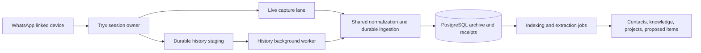

# WhatsApp ingestion through Tryx

Status: first archive milestone implemented in source on 2026-10-17. Deployment,
live pairing, account history coverage, and device UI acceptance remain unverified.
The later sections retain the researched target contracts and future work; the
implementation boundary below takes precedence where they differ.

The product contract is [MESSAGING_MEMORY.md](MESSAGING_MEMORY.md). First deliverable
is a reliable read-oriented text/metadata archive with contact identity linking;
intelligence builds on the same evidence rather than bypassing archive storage.

## Implemented milestone

- `messaging_normalization.py`: allow-listed text/caption and attachment-reference
  projection from Tryx messages/history, common edit/revoke handling, bounded text,
  original source timestamps, sender-scoped keys, and safe rejection of ambiguous
  group mutation authors. No attachment download API is called.
- Migration `0073_messaging_archive.sql` and `messaging_archive.py`: owner-scoped
  accounts, identities/manual contact associations and their audit history,
  conversations, observed sender membership (not authoritative join/leave history),
  messages/revisions, lexical indexes, and durable sanitized inbox/receipt rows.
  Live/history duplicates with the same source keys converge. Source deletion
  preserves the last known text and revision evidence; stale history cannot
  resurrect deleted state or overwrite an edit. Inbox commits are processing
  checkpoints; poisoned entries retry up to five times and can be retried manually.
- `whatsapp_native.py` and `whatsapp_runtime.py`: pinned `tryx==1.5.0+digitalbrain.1` in a managed
  Python child process inside the existing orchestrator container. Tryx's Python
  surface lacks explicit shutdown and durable upstream capture registration, so
  the child boundary permits termination/reaping and suppresses native raw logs.
  An advisory supervisor lease, per-session file lock, generation checks, and a
  parent-death watchdog prevent competing/stale clients. This is not another
  deployed container. The independent archive thread drains staged live/history
  records; incoming history normalization runs on a separate bounded lane.
- `/messaging/*`: authenticated status, connection control, no-store QR
  pairing, account/conversation context, identities/contact linking, pending retry,
  conversation listing, keyword search, and bounded exchange context. Exact
  normalized phone matches are suggestions requiring confirmation, not automatic
  associations. Corrected links immediately affect sender/direct-peer retrieval.
- Web System → Messengers → WhatsApp owns pairing/status, context defaults, conversation
  browsing/search, message context, and people linking (Unlinked, Suggested
  matches, Linked). People can be linked, corrected, unlinked, or created from
  the web. Web Contacts links directly to the relevant management view.
  Mobile has no WhatsApp management screens; archived knowledge remains available
  through normal search/chat and confirmed contact associations.
- `search_memories` includes source `message`; `get_message` inspects the matched
  exchange. Dates/sender attribution survive tool compaction, and the verifier
  requires inspection of the actual matching message before final synthesis.

### Historical import window and explicit requests

Historical imports are limited to six calendar months before the current UTC
instant, inclusive. `whatsapp_native.py` passes this boundary to `history_records`
so older messages are skipped before normalizing bodies/attachment metadata.
Shared staging and inbox draining enforce the same rule, including history
already queued before the limit was introduced. Live callbacks continue normally;
existing archived messages are not purged.

Upstream whatsapp-rust **does** expose
[`Client::fetch_message_history`](https://github.com/oxidezap/whatsapp-rust/blob/main/src/pdo.rs).
It asks the primary phone for older messages using chat JID, oldest known message
ID, whether that message was outgoing, its timestamp in milliseconds, and a batch
count. The method returns a request ID; history is delivered asynchronously.
This is an explicit protocol request, not a guarantee that all requested history
will be returned.

Digital Brain now builds `tryx==1.5.0+digitalbrain.1` from the immutable upstream
revisions in `vendor/tryx/manifest.json`. The checksum-verified patch exposes
`AdvancedClient.fetch_message_history` and fixes the upstream Cargo.lock root
version without changing dependency resolutions. The orchestrator Dockerfile
builds the wheel in a Rust/Python build stage, installs it in the existing runtime
image, and asserts the method exists. The CI Python-test job builds/caches the
same wheel before installing requirements. See [the patch build instructions](../../vendor/tryx/README.md)
for host development; an ordinary PyPI 1.5.0 wheel no longer satisfies the pinned
runtime requirement. No extra deployed service is introduced.

The requester starts after a successful self-identity check and initial sync.
It seeds cursors from initial history or existing archived, non-deleted messages,
then requests batches of 100 older messages, paced at ten seconds with only one
outstanding application request per account. `0075_whatsapp_history_requests.sql`
persists per-chat anchors, pending request tokens, attempt counts, and outcomes.
Anchors advance only after sanitized callback staging commits; a failed chunk
leaves the previous cursor available for retry. Duplicate chunks do not reset the
retry count or extend the deadline. Distinct older cursors at the same timestamp
can advance without looping over a previously seen anchor.

Each pending request has a two-minute response deadline. Send failures back off
by one minute per attempt; at most three attempts are made per unchanged anchor.
An unavailable or repeatedly unanswered page becomes stalled and can be retried
from web System → Messengers → WhatsApp. Retry is owner-scoped. A source-exhausted
flag or crossing the six-month cutoff ends traversal; a completed transfer with
more messages on the phone does not mean source exhaustion. The requester never
marks an unanswered page as complete. Late generation/send completions cannot
rewind a newer cursor. The phone must be reachable and willing to provide history;
missing response correlation in Tryx means progress is matched per account/chat.

### Capture guarantee and remaining work

Durability begins after a sanitized callback projection reaches PostgreSQL staging.
Tryx's observer path does not expose upstream before-ACK hooks, so a process
crash or observer overflow before staging can lose an observation. The separate
history worker cannot recover history the provider never supplies. Status records
observed-only coverage and bounded capture-failure counts; never label this a
complete or lossless archive. Stronger before-ACK capture requires a targeted
Tryx/upstream extension and is not implemented by the Python staging queue.

The base Tryx revision is `fa649633165484910145a933fe14979f81fd3837`, with
whatsapp-rust submodule `539ed050817f351d080fb5092179b22cebaceffe`. The local
history patch does not add before-ACK durability hooks or broaden attachment
storage. Build/import checks and deterministic requester/database tests do not
establish complete history delivery from a real account.

Only one WhatsApp account binding per Digital Brain owner is supported initially.
A changed self phone identity is rejected instead of silently merging another
account into the archive. LID/phone cross-alias consolidation, authoritative
membership updates, additional protocol variants, archive purge UI, and live
history coverage validation remain follow-up work. Different wire sender aliases are not
currently deduplicated into one canonical message; each can be linked to the same
contact manually. Search is lexical; semantic passages are not implemented yet.
Projects, temporal knowledge/contact enrichment, generalized proposed items, and
daily cross-source reasoning remain the later product milestones.

### Running and checking the milestone

Rebuild the existing orchestrator image to build/install the pinned history-enabled
Tryx wheel and QR dependencies. A restart alone does not replace the native wheel.
Normal backend startup applies migration 0073 and starts the dormant supervisor and
archive worker. No extra service or manual migration/index command is required.
The Compose service has init enabled and mounts `/app/storage/whatsapp` persistently;
that private session directory is excluded from Git and Docker build contexts.
Do not copy session keys into ordinary diagnostic exports or unencrypted backups.

Open web System → Messengers → WhatsApp, choose Connect WhatsApp,
and scan its QR using WhatsApp → Linked devices on the main phone. Connection is
explicit; the code change does not pair an account or deploy/restart production.
Disconnect stops capture while retaining both archive and session for reconnection.
Remote device revocation is still performed in WhatsApp's Linked devices screen.

Private SQLite/session files use a 0700 directory and child-process 0077 umask.
Text is capped at 64 KiB per message, application history chunks at 32 MiB, staging
batches at 100 items, pending inbox at 50,000 items/128 MiB stored-payload budget,
and archive draining at 50 rows per transaction. These application bounds do not
certify the native SDK's pre-callback memory or protocol-store behavior. Inspect
those with a live account before declaring full attachment-storage or delivery
coverage. New normalized application records contain attachment references only.

Focused contract tests live in `tests/test_messaging_archive.py`. Set
`MESSAGING_TEST_DSN` to a disposable PostgreSQL DSN to run the migration/owner/
replay tests; they create/drop only uniquely named test schemas. Tests using the
actual WhatsApp protobufs require the pinned Tryx dependency. Existing conversation,
registry, validator, and tool execution tests cover adjacent behavior. Native
compatibility and those tests do not establish production delivery or visual sign-off.

Validation recorded for this milestone: 200 targeted backend checks passed,
including 25 archive/native/protobuf contracts with disposable PostgreSQL; changed
Python files pass Ruff. The management refactor passes web typechecking and
focused lint, and 26 archive/API contracts against disposable PostgreSQL. Mobile
management screens were removed; unrelated mobile changes were preserved.
Native offline
initialization passed on macOS and on Linux amd64/Python 3.11. No production rebuild,
live pairing, complete-history claim, or on-device visual validation is implied.

Telegram now shares the archive, web manager, and memory retrieval. Management
requests remain provider-scoped; no provider parameter defaults to WhatsApp.
See [TELEGRAM_INGESTION.md](TELEGRAM_INGESTION.md).

## Upstream evidence

Requested dependency: [oxidezap/whatsapp-rust](https://github.com/oxidezap/whatsapp-rust).
Inspected source revision: `135e1aebf9d62c06da17ae4516a90554a472c60e` (package 0.7.0).
This records the research baseline; validate and pin a specific revision plus
Cargo.lock when implementing rather than tracking main or assuming a release has
the same APIs. No build or live account test was performed for this plan.

| Source at inspected revision | Finding and consequence |
| --- | --- |
| [README](https://github.com/oxidezap/whatsapp-rust/blob/135e1aebf9d62c06da17ae4516a90554a472c60e/README.md) | Async WhatsApp Web library with QR/pairing-code authentication, persistent sessions, direct/group messages and history sync; it is an unofficial client, and upstream warns of possible account suspension |
| [Cargo.toml](https://github.com/oxidezap/whatsapp-rust/blob/135e1aebf9d62c06da17ae4516a90554a472c60e/Cargo.toml), [toolchain](https://github.com/oxidezap/whatsapp-rust/blob/135e1aebf9d62c06da17ae4516a90554a472c60e/rust-toolchain.toml) | Rust edition 2024; repository pins nightly-2026-06-16; default stack includes SQLite/Tokio. Verify consumer toolchain requirements in the build spike |
| [Durability hooks](https://github.com/oxidezap/whatsapp-rust/blob/135e1aebf9d62c06da17ae4516a90554a472c60e/src/types/durability_hook.rs) | Separate live-message and history capture gates; neither generic callbacks nor missing receipts establish complete recovery |
| [Event delivery](https://github.com/oxidezap/whatsapp-rust/blob/135e1aebf9d62c06da17ae4516a90554a472c60e/src/bot/event_delivery.rs) | Bounded asynchronous observers can drop on overflow; ordered callbacks are not a durable inbox |
| [Group notification hook](https://github.com/oxidezap/whatsapp-rust/blob/135e1aebf9d62c06da17ae4516a90554a472c60e/src/types/group_notification_durability.rs) | Full original group notification bytes must be durably stored before effects/ACK; ID and replay ambiguity require explicit handling |
| [Event types](https://github.com/oxidezap/whatsapp-rust/blob/135e1aebf9d62c06da17ae4516a90554a472c60e/wacore/src/types/events.rs), [message identity](https://github.com/oxidezap/whatsapp-rust/blob/135e1aebf9d62c06da17ae4516a90554a472c60e/wacore/src/types/message.rs) | Message batches, contacts, membership updates, history, and delete-for-me signals exist; retain sender/chat-scoped message keys and verify edit/revoke payload normalization in fixtures |

Source inspection establishes API availability, not deployment reliability or how
much history a real account will supply. The unofficial-client account risk is a
material dependency choice, not a generic warning to display throughout the app.

## Bridge decision and same-container alternatives

Deployment target: the existing orchestrator container. Another container is not
required. Process isolation and container separation are independent decisions.
The earlier separate-container recommendation is superseded by this target.

Chosen integration: Tryx embedded in the Python environment inside the existing
orchestrator container. Run live capture continuously and historical injection
through a separate background worker. Both feed the same normalized archive path.
Implementation still needs to verify the selected Tryx revision's capture guarantees.
Do not treat the direct upstream revision above as Tryx's pinned submodule revision.
If missing capabilities need adaptation, prefer a narrow Tryx/upstream extension;
the same-container Rust subprocess remains a contingency, not the default design.

| Candidate | Evidence checked on 2026-10-17 | Decision |
| --- | --- | --- |
| [Tryx](https://github.com/krypton-byte/tryx) | README documents async Python APIs, sessions and contacts/groups; [Cargo.toml](https://github.com/krypton-byte/tryx/blob/master/Cargo.toml) defines a PyO3 extension backed by a whatsapp-rust submodule | Selected and integrated at 1.5.0; offline native checks passed. Live coverage and stronger capture hooks remain open; see implemented boundary above |
| [wars](https://github.com/marketcalls/wars) | Python wrapper exists, but inspected [binding source](https://github.com/marketcalls/wars/blob/main/src/lib.rs) explicitly calls `skip_history_sync()` and uses an unbounded event queue; README lists missing edit/revoke/contact lookup APIs | Does not satisfy archive needs as inspected; adopting it would require substantive extension |
| Thin project-owned PyO3/maturin binding | [PyO3](https://pyo3.rs/main/) supports native Python extensions | Possible if a small binding can expose the required durable capture without maintaining a broad SDK; adds native wheel and runtime integration work |
| Rust subprocess in existing container | Build a binary in a Rust stage and copy it into the Python image | Reliable fallback with control over upstream hooks, independent restart, and no new deployed service/container |

The alternative comparison began as source research; Tryx has since been installed
and checked offline. No account has been paired. A wrapper exposing message
callbacks is not sufficient evidence of before-ACK durable capture. Missing hook
exposure can require upstream contribution, a narrow binding, or the fallback.

The selected topology keeps both ingestion lanes in the existing container:

Rust owns connection/reconnection, session keys, protocol decoding, and durable
capture/delivery. Python owns authenticated user/account binding, validation,
normalization into the shared domain, contacts, canonical archive, retrieval, and
intelligence. The Rust store is a delivery/session store, not the memory database.

## History worker and live capture

The separate history thread means background execution in the same deployment,
not another Codex chat, container, or independently paired WhatsApp session. Use
an async task for asynchronous I/O or a managed worker thread for blocking decode
work, following existing backend job patterns. Keep a single session owner per
account across both lanes and guard against duplicate API worker/replica startup.

- Live capture persists promptly without waiting for the full historical import.
- Stage available history durably before processing it in bounded batches. The
  Tryx adapter must honor the capture gates and attachment exclusions described
  below; a transient Python callback queue is insufficient.
- Persist import job state and checkpoints so a process restart resumes work.
  Prioritize live traffic and bound history CPU, memory, queue size, and inference.
- Normalize both lanes through the same account/identity/message/revision rules.
  Overlapping history/live observations add evidence instead of duplicate messages.
- Keep original sent time and ingestion time distinct. Old messages do not replace
  newer known edits or current knowledge solely because they were imported later.
- Index historical batches and schedule bounded extraction separately; do not send
  the entire backfill through the interactive path or flood Proposed items with
  obsolete tasks. Check historical candidate work against current evidence/status.
- A worker processes history we can obtain; it does not itself recover history
  absent from Tryx/WhatsApp. Verify history acquisition separately, and record
  observed ranges/gaps without promising a complete archive. A future explicit
  export importer can feed this same pipeline if another source is needed.

This chooses execution separation, not a specific unverified Tryx history API.

Tradeoffs:

- The current Python 3.11/uvicorn image can contain either a native extension or
  another binary. Rust build tooling belongs in a build stage, not the runtime.
- In-process bindings avoid IPC but couple native faults and Tokio lifecycle to
  Python. Verify FastAPI startup/shutdown and avoid blocking its event loop.
- The subprocess option keeps native runtime isolation without another container.
  Python owns launch, health polling, bounded restart/backoff, signals, and reaping.
  Acquire an exclusive account/session lease so multiple uvicorn workers or
  replicas cannot start competing clients. Container restart still stops both.
- Use loopback HTTP with explicit commit ACKs for the fallback, not an ephemeral
  stdout-only message stream. No broker or exposed ingestion endpoint is needed.
- A separate container remains optional future packaging if independent deployment
  becomes useful. It is not a prerequisite for this integration.

Only the connector implementation can use upstream send primitives; do not expose
send/reply/react/mark-read/delete operations in the application API. Required
transport acknowledgements are not read receipts. Verify incidental protocol
behavior in the account test rather than claiming a read-only protocol client.

## Proposed private contract

These are fallback subprocess design contracts, not upstream HTTP endpoints.
With bindings, preserve the same operations and delivery semantics in a Python
adapter without starting an HTTP server. Version all payloads.

- `GET /v1/health`: bounded liveness/readiness, no identity or content.
- `POST /v1/accounts/{binding}/pairing`: start explicit pairing; owner-authorized
  control path retrieves short-lived QR/code material without logging/caching it.
- `GET /v1/accounts/{binding}/status`: safe connection, pairing, queue, and observed
  history coverage state.
- `GET /v1/accounts/{binding}/events?limit=...`: bounded durable unacknowledged
  batch with stable event IDs, byte limit, schema version, and delivery sequence.
- `POST /v1/accounts/{binding}/events/ack`: acknowledge explicit committed event
  IDs scoped to the binding. No global "ack everything before timestamp" operation.
- `POST /v1/accounts/{binding}/disconnect`: stop capture/session use; separate
  explicit unlink/revoke and archive deletion semantics.

Bind each connector account to a Digital Brain owner on the authenticated Python
side. A source event cannot choose its owner or reassign its account. Use a
dedicated secret scoped to this internal service, not user tokens or broad
orchestrator credentials. For the subprocess fallback, bind only to loopback; publish no connector port. Browser/mobile
pairing/status/linking calls go through the existing frontend proxy, with `/mobile`
for the mobile app. The Rust service must never be called directly by clients.

An event envelope includes `schema_version`, stable `event_id`, account binding,
delivery sequence, event kind, origin (live/history/recovery), observed time,
source time when known, and a typed payload. Payload kinds cover identity aliases,
conversations, memberships, messages, edits/revocations, attachment references,
and coverage/gap observations. Unknown kinds fail closed into bounded private
quarantine; they are not silently acknowledged as archived messages.

## Durable capture, replay, and normalization

1. In the Rust live inbound hook, atomically commit an idempotent, sanitized
   projection plus outbox entry before returning success. No Python/LLM/network
   dependency inside the capture hook. Message identity includes account binding,
   source chat, source sender, and source message ID, not just the message ID.
2. Upstream also buffers pending live messages in its protocol store. These may
   contain protocol/media metadata; keep them private, bounded, and separate from
   the archive, with no attachment download. Audit actual storage in the spike.
3. Register the history capture hook separately. It receives compressed chunks
   before validation and has no library-managed durable replay buffer. Bound
   compressed/decompressed sizes, parse safely, and persist archive projections
   before success. An implementation may need a bounded private chunk journal
   for crash-safe parsing; audit inline thumbnails/media before choosing storage.
   Do not persist attachment bytes even embedded in raw history. If sanitizing
   durably within the hook cannot satisfy upstream semantics, adapt the connector
   or upstream hook rather than weakening the attachment policy silently.
4. Register the group notification durability hook when claiming membership
   reliability. Persist its required original envelope and an outbox record in a
   private bounded journal, then derive typed changes. Scope IDs to account/group;
   changed bytes under the same ID are a conflict. ID-less identical notifications
   have replay ambiguity. Other observer-only updates have weaker guarantees;
   count gaps and reconcile metadata where possible.
5. Python polls the outbox, validates a bounded batch, and commits archive records,
   connector event receipts, and downstream job work atomically in PostgreSQL.
   Acknowledge to Rust only after that transaction commits.
6. Lost ACKs replay the same events. Receipts prevent duplicate effects. The
   connector removes delivered queue records after ACK; archived source evidence
   stays in PostgreSQL. Serialize each account's delivery lane initially.
7. Source key plus revision/hash distinguishes transport duplicates from edits.
   Cross-check live/history overlap and original identifiers after alias changes.
   Delivery sequence is local observation order, not provider chronology. Late
   history cannot overwrite a later known edit or resurrect revoked current text.
8. Disk/queue limits stop admission before discarding accepted records. Apply
   bounded retry/backoff and safe degraded status. Upstream withholding ACK does
   not guarantee indefinite retention/redelivery; record coverage limitations.

The hooks cover different origins. Encrypted direct/group live/offline messages
use the live gate. Newsletter/channel and PDO recovery paths are event-only at
this revision; do not promise equal durability. The initial supported scope is
direct and group text/metadata. Report unsupported origins explicitly and leave
newsletters/status/calls and media processing outside the first milestone.

Preserve WhatsApp LID/phone-number identifiers as distinct aliases until an
evidenced mapping establishes equivalence. Never assume every JID is a phone
number or merge identities by display name. Keep account self-identities explicit
and test outgoing messages sent on the phone as well as incoming messages.

Store attachment type, supplied filename/size, caption, and parent message/source
locator only. Drop media keys, signed download URLs, thumbnail payloads, and other
download capabilities from normalized archive/outbox payloads. Protocol history
sync blobs are not attachment downloads, but still need the inline-content audit
above. No media download APIs, OCR, transcription, Immich upload, or attachment
content inference. A usable per-message WhatsApp deep link is unverified; provide
conversation/sender/time navigation hints without fabricating one.

## Deployment and operations

Extend the existing orchestrator image during implementation. Install a verified
native wheel for the binding path, or use a multi-stage Rust build and copy the
connector binary into the Python runtime image. No additional Compose service is
required. Pin wrapper/submodule revisions or upstream revision, lockfile, and tested
toolchain. Initial target follows the existing `linux/amd64` deployment. Keep
runtime least-privileged, with a private persistent session/outbox directory or
volume, bounded disk use, and one active connector per account. Backups must protect
session keys; restores/re-pairing must not create another canonical account/archive.
For subprocess packaging use a minimal init for signal forwarding/child reaping
and test Python-owned lifecycle, including parent failure and orphan prevention.
[Docker documents multiple processes in one container](https://docs.docker.com/engine/containers/multi-service_container/).
The WhatsApp connection failing must not take down unrelated chat/API functions;
readiness/status should distinguish connector failure from overall API health.

Protocol session stores necessarily contain sensitive authentication material;
keep them out of Git, logs, diagnostics, and general archive responses. Decide
encrypted backup inclusion/exclusion and session recreation explicitly. Application
attachment storage remains prohibited. Graceful stop drains/finishes durable
commits before exit, and restart resumes local outbox work independently of Python.

Expose only safe counters, queue age/size, last successful ingest, connection state,
and bounded error codes. Never log message text, raw event payloads, phone/JID,
contact names, pairing codes, keys, or URLs. Upstream tracing defaults do not certify
every log site: audit logging and keep `tracing-pii` off. No content in Mirador.

## Implementation sequence and completion evidence

1. **Connector spike:** implement against selected Tryx and verify its pinned upstream. Verify native
   packaging in the Python 3.11 image and the required history/live durability
   surface. If it cannot meet the contract, use a narrow binding or same-container
   Rust subprocess. For the selected path, pin/build dependencies, validate durable hooks
   and SQLite behavior, audit incidental media persistence and log output, and map
   incoming/outgoing, history, edit/revoke, contact aliases, and group events into
   sanitized fixtures. No production pairing is required to write fixture tests;
   an explicitly started account session is required for live coverage evidence.
2. **Shared archive foundation:** owner-scoped accounts, identities/aliases, contact
   links, conversations/membership, message revisions, attachment references,
   evidence, and connector receipts. Define migrations and conflict rules first.
3. **Embedded bridge:** Tryx adapter, durable capture, live ingestion, and separate
   checkpointed history worker using existing job infrastructure. Validate shared
   normalization, overlapping live/history imports, bounded backfill, same-container
   packaging, commit acknowledgements, single account ownership, and FastAPI/native
   runtime shutdown. Subprocess delivery remains a contingency if required.
4. **Usable archive:** searchable messages/context, coverage/status, explicit
   archive/monitoring settings, Work/Personal defaults, and web identity linking.
   Pair with the intended account and measure available history, gaps, self-message
   coverage, and source navigation on the real device/account.
5. **Knowledge and projects:** temporal evidenced facts/contact updates, projects,
   assignees, and typed proposed items. Integrate existing meeting outcomes without
   silently changing their current task creation semantics.
6. **Cross-source intelligence:** incremental extraction, daily review with durable
   checkpoints, deduplication including dismissed/completed items, and briefing
   presentation. Demonstrate one evidence-backed next step from multiple sources.

Focused validation must include owner/account isolation; duplicate live/history
delivery; same message ID across different senders/chats; crash before/after Rust
commit and Python commit; lost ACK; out-of-order history/edit/delete; unknown reply
targets; LID/phone alias changes; source delete retaining archive; explicit archive
purge; queue/disk exhaustion; stale pairing/disconnect; and no attachment bytes or
secrets in application storage/logs. Later intelligence checks cover uncertainty,
contact correction propagation, dismissed proposal suppression, and manual edits.

A successful fixture suite/build proves the bridge contract, not account reliability
or complete history. Live acceptance requires observed text delivery across restart
and Python outage, measured history coverage, and verified absence of media download.

### Explicit-history validation

The patched native wheel builds and imports on macOS arm64/Python 3.12. The real
native binding rejects invalid batch counts and requires a running authenticated
client for valid arguments, without connecting an account in the test. A final
226-test selection passes with this patched wheel, including the archive/API,
backfill state machine, six-month cutoff, native binding, memory-tool and adjacent
controller regression tests. Web typechecking/focused lint and changed-Python
Ruff checks also pass. The Linux amd64/Python 3.11 release wheel builds and imports in the
Docker build stage. An isolated network-disabled container also validates the
real method, argument guards, and SQLite initialization. None of this is evidence of live primary-phone history delivery.
